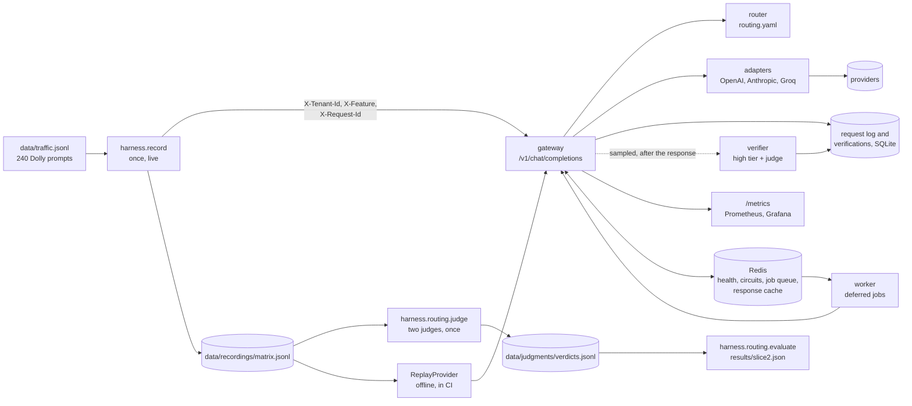

# llm-gateway

An OpenAI-compatible gateway in front of OpenAI, Anthropic and Groq that routes each request by cost, attributes it to a tenant and a feature, and keeps answering when a provider fails. On 238 replayed prompts, **sending every request to the cheapest model kept 95.8% of answers acceptable to two judges at 95.6% less cost than the reference model**, passing a pre-registered quality bar; the learned classifier the plan called for passed too, but saved only 61.6%. **When that model's provider failed every call, failover kept client errors at 0%**, in simulated outages and in a live run of 90 real requests, and a circuit breaker redesigned under a pre-registered study stopped calling the failed provider after 2.7 s instead of 20.2 s. **An exact response cache keyed on tenant, prompt version, model and parameters cut cost by 19.8% and p50 latency from 2.1 s to 1.7 s** on a production-shaped replay of 1,000 queries; a semantic layer was built, judged and left off, because at its pre-registered floor it made p95 latency worse and its false-hit rate could only be bounded at 6.7%, not 1%. The project's live calls cost US$ 4.64 in total.

[Versão em português](README.pt-br.md)

## Result

All four slices are done. Every number below is recomputed offline from committed recordings and runs, and CI fails if a published number goes stale.

### Slice 4: response cache

A cache in front of the model has to prove it saves something without serving wrong answers. The workload ([harness/cache/prereg.py](harness/cache/prereg.py), fixed before any paid call) is 1,000 queries built from Dolly: 600 repeat 160 questions, each asked in its original wording or one of 4 paraphrases written by gpt-4.1-mini, with a Zipf distribution so a few questions come back often; 320 are the Dolly records nearest to those questions by embedding (similar wording, usually another question); 80 are random. Queries come from three tenants. The replay sends them through the real gateway code with gpt-6-luna's recorded answers and recorded embeddings, so it is free and CI repeats it. The hit rate is a property of this workload, which was built to repeat; it is not a claim about real traffic.

| | no cache | exact layer only (served) | exact + semantic at 0.96 |
|---|---|---|---|
| hit rate | - | 23.3% | 27.7% (16.7% exact, 11.0% semantic) |
| cost per 1,000 queries, US$ | 0.0985 | 0.0790 (-19.8%) | 0.0770 (-21.9%) |
| p50 latency | 2,112 ms | 1,728 ms | 2,035 ms |
| p95 latency | 6,200 ms | 5,990 ms | 6,314 ms |

Latency is built from the recorded model call and the recorded embedding call; the cache lookup itself is not included.

- **The exact layer is what the gateway serves.** It answers only the same text from the same tenant under the same system prompt, prompt version, model and parameters, so it cannot answer a different question. Only answers that finished normally, from the model the request was meant for, are stored.
- **The semantic layer was judged, not assumed.** Every distinct semantic hit at any floor from 0.80 to 0.99, 150 pairs, was graded by the slice 2 judges (gpt-4.1-mini and claude-sonnet-5-5): is the cached answer as good for this question as the model's fresh answer? They agreed on all 150. 7 were false hits, 6 of them between different Dolly questions: high schools in Arlington answered with the count of elementary schools (similarity 0.959), "the seven most recent Indian prime ministers" answered with three, Shiba Inu the cryptocurrency answered as the dog breed and the reverse, Meiolania answered as Megalania. The seventh was a paraphrase whose cached answer had a country out of order.
- **The pre-registered floor met the claim's letter, not its spirit.** The rule picked the lowest floor with at most 0.5% false hits on the tune half: 0.96. On the test half that floor served 0 false hits in 53, a point estimate below 1%, but the exact 95% interval reaches 6.7% (and 28.5% over the 11 distinct pairs behind those hits). The workload is too small to show a rate under 1%. The floor also sits 0.001 above a real false hit.
- **The semantic layer costs latency on every request it does not answer.** The embedding call took 329 ms at p50 and 477 ms at p95, and every request the exact layer misses pays it. At 0.96 that made p50 slower than the exact layer alone and p95 slower than no cache. The 2 extra points of savings are US$ 0.002 per 1,000 queries, because gpt-6-luna is cheap. That is why it is off; it is one line in routing.yaml to turn on.

| floor | semantic hits | false hits | false-hit rate |
|---|---|---|---|
| 0.80 | 269 | 8 | 3.0% |
| 0.87 | 217 | 2 | 0.9% |
| 0.90 | 169 | 2 | 1.2% |
| 0.95 | 128 | 1 | 0.8% |
| 0.96 | 110 | 0 | 0.0% |
| 0.98 | 40 | 0 | 0.0% |

Both halves together; the full curve, per half, is in [results/slice4.md](results/slice4.md).

- **The key is what keeps tenants apart.** Replayed with the question alone as the key, 228 of 371 hits would have served an answer computed for another tenant. After the system prompt version changed, 0 hits used an answer stored under the old version; the same 200 queries under the old version got 198 hits.
- **A blind human check confirmed the judges' rejections.** I graded 22 pairs without seeing the verdicts: 15 the judges accepted and all 7 they rejected. I rejected 6 of the 7 and agreed on 19 of 22. Two disagreements were paraphrases I rejected for leaving out or adding a sentence nobody asked for, which the rubric does not penalize; in the third, the judges caught the country out of order and I did not.

Provider-side prefix caching is out of scope: the system prompt is about 15 tokens, and OpenAI caches prompts of at least 1,024 tokens for GPT-5.6 and later models ([prompt caching guide](https://developers.openai.com/api/docs/guides/prompt-caching)).

### Slice 3: reliability under provider faults

Two gateway instances share per-provider health, circuit state and a job queue in Redis. The fault tests run over simulated providers that replay the recorded answers at the recorded latency, so they cost nothing and can be repeated: open-loop traffic at 4 requests per second, a fault on openai (the low tier's provider) from 20 s to 60 s of a 100 s run, 3 repetitions per cell. Each study's design and pass criteria were committed before its runs ([prereg.py](harness/chaos/prereg.py), [prereg_v2.py](harness/chaos/prereg_v2.py), [deferrable.py](harness/chaos/deferrable.py)).

| fault on openai | client errors, no failover | client errors, failover | breaker v1 opened after | breaker v2 opened after | wasted calls, v1 / v2 |
|---|---|---|---|---|---|
| outage (every call fails) | 100.0% | 0.0% | 20.2 s | 2.7 s | 81 / 11 |
| partial (50% of calls fail) | 48.8% | 0.0% | never | 5.2 s | 84 / 15 |
| timeouts (every call hangs 10 s) | 100.0% | 0.0% | 30.2 s | 12.5 s | 120 / 51 |
| latency (35 s added) | 0.0% | 0.0% | 37.5 s | 32.5 s | 0 / 0 |

Medians of 3 repetitions. Wasted calls are requests in the fault window that made a failing call to openai. With a breaker, client errors stay at 0.0% in every scenario.

- **Failover is what keeps clients answered; the breaker saves wasted calls and time.** Requests sent with `"model": "auto"` move to the tier's fallback on a retryable error. Under timeouts the p50 latency was 12.9 s with failover alone, 11.7 s with breaker v1 and 3.5 s with v2, because an open circuit skips the 10 s wait.
- **v2 replaced v1 after a pre-registered comparison.** v1 counted the shared 60 s health window, so under a total outage it had to wait for failures to outnumber the healthy calls still in the window (20.2 s), and in the latency scenario slow calls that finished after the circuit closed reopened it. v2 counts the last 20 calls admitted since the circuit last moved, ignores calls admitted before that, and lists a call as slow while it is still running. Both versions were run again, interleaved, in the same session. Every criterion held: faster opening in the three detection scenarios, opening at 50% errors, no reopening after recovery, no trip with no fault or with 10% errors, and no client metric worse than v1 ([results/slice3_breaker_v2.md](results/slice3_breaker_v2.md)). v2 was designed after seeing v1's results; the criteria were fixed before v2's runs, not before v1's.
- **v2 has costs the criteria did not cover.** A 20-call window is a small sample: under a steady error rate well below the 50% threshold it can still see half its calls fail. The exact binomial probability that one evaluation trips is 0.26% at 20% errors and 4.8% at 30% errors (computed, not measured). At 50% errors v2 sends 91% of traffic to the fallback, against 52% for v1, and the fallback costs about twelve times more. Time to close after recovery depends on where the open and probe cycle is: under timeouts it was 15.0 s for v2 and 8.7 s for v1.
- **Neither breaker fixes added latency.** With 35 s added to every openai call, p95 was 41.0 s in every configuration; the breaker opens only once calls have run past 30 s.
- **The low tier fails over to claude-haiku-4-5, not to gpt-oss-20b.** Under one judge (gpt-4.1-mini), Haiku was acceptable on 97.1% of the 238 prompts, the same as gpt-6-luna, while gpt-oss-20b dropped to 85.3% (11.8 points lower, 95% CI [7.6, 16.4]). Haiku costs about twelve times luna while a failover lasts. The equal quality depends on the judge: under the stricter two-judge consensus of slice 2, Haiku was accepted on 85.7% against luna's 95.8% ([results/slice3_fallback_quality.md](results/slice3_fallback_quality.md)).

**Deferrable work.** When both the low tier's provider and its fallback's provider fail, an interactive request has nowhere to go: in this test every interactive request during the double outage failed. A request sent with `X-Deferrable: true` is queued instead (202 and a job id) and a worker sends it through the gateway later, with backoff. Test: openai and anthropic both fail from 20 s to 60 s, 160 jobs arrive at 2 per second, each submitted twice with the same `Idempotency-Key`, and one of the two workers is killed at 65 s. Run 1 exposed two defects; run 2 is the same test after fixing them ([results/slice3_deferrable.md](results/slice3_deferrable.md)).

| run | jobs done | jobs failed | unfinished at 300 s | jobs answered twice | duplicate submissions absorbed | queue empty after the fault ended |
|---|---|---|---|---|---|---|
| 1: one job at a time, 8 attempts | 74 to 80 of 160 | 16 to 26 | 54 to 70 | 0 | 160 of 160 | never |
| 2: 8 jobs in flight, 15-minute age budget | 160 of 160 | 0 | 0 | 0 | 160 of 160 | 55 to 58 s |

Ranges over 3 repetitions. Run 2's drain time includes the 20 s during which jobs were still arriving. Delivery is at least once: a job whose worker dies after the model answered but before the result is stored is answered again. No run hit that window, so 0 duplicates is what was observed, not a guarantee.

**Live run.** The same outage, with real models: two instances, 90 Dolly requests at 1 per second, answers capped at 256 tokens, openai failing every call from 20 s to 60 s (the fault is injected in the gateway, so failed calls cost nothing). All 90 requests were answered: 20 by gpt-6-luna before the fault, 40 of the 41 during it by claude-haiku-4-5, and 27 of the 29 after it by luna again. The circuit opened after 10 of the last 20 calls failed, one probe failed while the fault lasted, and the next one closed it. 15 of the 90 answers were cut at 256 tokens, the limit that kept the run's worst case at US$ 0.22; it cost US$ 0.031 ([summary](data/chaos/live/slice3_live_video/summary.json)).

https://github.com/user-attachments/assets/44096512-893a-4faf-9360-3e24214e68e7


The video is the dashboard during that run, at twice the speed. Prometheus scrapes every 2 s, so a half-open state shorter than that can be missing from the circuit timeline: the failed probe does not appear.

### Slice 2: routing by cost, verified by judges

Each candidate answer was graded against the reference answer (gpt-6.1-sol) by two judges from two providers, gpt-4.1-mini and claude-sonnet-5-5; it counts as acceptable only when both accept it. An answer cut by the output limit or empty fails by rule, on every tier. Learned policies were scored out of fold, 5 folds stratified by request class. The policies, the threshold, the quality bar (lower end of the 95% interval at least 90%) and the comparisons were fixed in [harness/routing/prereg.py](harness/routing/prereg.py) before any verdict existed.

| policy | acceptable answers (95% CI) | cost per 1,000 requests, US$ | cost reduction vs always_high | low / medium / high | meets bar |
|---|---|---|---|---|---|
| always_high (gpt-6.1-sol) | 99.6% [98.7, 100.0] | 2.046 | 0% | 0 / 0 / 100% | yes |
| **always_low (gpt-6-luna)** | **95.8% [93.3, 98.3]** | **0.089** | **95.6%** | 100 / 0 / 0% | yes |
| always_medium (claude-haiku-4-5) | 85.7% [81.1, 89.9] | 1.104 | 46.1% | 0 / 100 / 0% | no |
| feature_table | 95.4% [92.4, 97.9] | 0.566 | 72.3% | 75 / 13 / 12% | yes |
| classifier (pre-registered primary) | 95.8% [93.3, 98.3] | 0.786 | 61.6% | 67 / 0 / 33% | yes |
| oracle (perfect routing, a ceiling) | 99.6% [98.7, 100.0] | 0.190 | 90.7% | 96 / 3 / 2% | yes |

What it shows:

- **The simplest policy won.** The classifier met the bar, as pre-registered, but always_low reached the same acceptance at about a ninth of its cost. The classifier sent a third of the traffic to the expensive model and gained no acceptable answer for it. Against the feature table, the pre-registered McNemar test found 1 prompt in favour of the classifier and 0 against (p = 1.0), and the classifier cost US$ 0.22 more per 1,000 requests.
- **There is room for a router, and cheap features do not find it.** The oracle reaches 99.6% while sending only 2% of requests to the expensive model. Prompt length, a context block, a few instruction keywords and the request class do not predict which 4% of requests gpt-6-luna fails.
- **The medium tier was worse than the low one.** claude-haiku-4-5 costs twelve times what gpt-6-luna does and was accepted on 85.7% of prompts against 95.8%. Price order is not quality order.
- **The judges agree on 93.2% of 474 pairs** (Cohen's kappa 0.36); Sonnet is the stricter one. A blind human grader and the judge consensus agree on 27 of 30 sampled answers. The 3 disagreements are answers the human accepted and the judges rejected for a named factual error (two instruments classified the wrong way round, Melbourne listed on the east coast, a hard size threshold for round planets). The human accepted all 30, so kappa is 0 by construction and the raw count is the informative number.

The gateway serves `always_low` from [llm_gateway/routing.yaml](llm_gateway/routing.yaml), read again whenever it changes. A sampled verifier watches that choice after the response is sent: it asks the high tier the same request, has gpt-4.1-mini judge the routed answer, and records every verdict within a daily cap. From the recorded verdicts ([results/slice2_verifier.md](results/slice2_verifier.md)):

| sample rate | overhead per 1,000 requests, US$ | overhead vs serving cost | total cost reduction vs always_high | failures caught per 1,000 |
|---|---|---|---|---|
| 1% | 0.023 | 26% | 94.5% | 0.3 |
| 5% (configured) | 0.116 | 131% | 90.0% | 1.5 |
| 10% | 0.233 | 261% | 84.3% | 2.9 |

One verification costs about 26 times what serving the request cost, because it goes to the model always_low avoids. The verifier is a monitoring instrument: it measures the failure rate and collects routing failures as training examples (with prompt features, never prompt text); it does not fix the answer a user already has. Its single judge flags 7 of the 10 failures the two-judge consensus finds.

Full tables, including acceptance by request class: [results/slice2.md](results/slice2.md).

### Slice 1: the spine

Each of 240 prompts was sent once to each of six models and recorded, for US$ 1.92.

| model | tier | cost per 1,000 requests, US$ (95% CI) | mean output tokens | cut at 1,024 tokens | p50 latency, s | p95 latency, s |
|---|---|---|---|---|---|---|
| gpt-6.1-sol | high | 2.12 [1.88, 2.36] | 185 | 3 of 240 | 4.7 | 16.5 |
| claude-sonnet-5-5 | high | 4.21 [3.85, 4.57] | 381 | 7 of 240 | 3.4 | 10.1 |
| claude-haiku-4-5 | medium | 1.13 [1.05, 1.21] | 197 | 0 of 240 | 2.3 | 4.7 |
| gpt-oss-120b (Groq) | medium | 0.32 [0.29, 0.35] | 483 | 62 of 240 | 1.3 | 2.9 |
| gpt-6-luna | low | 0.09 [0.08, 0.10] | 158 | 2 of 240 | 2.3 | 6.1 |
| gpt-oss-20b (Groq) | low | 0.12 [0.11, 0.13] | 357 | 18 of 240 | 0.6 | 1.7 |

- **Price per token is not cost per request.** gpt-6.1-sol and claude-sonnet-5-5 have the same list price, but Sonnet costs twice as much per request: about twice the output tokens (381 against 185), and the same prompts count as about 50% more input tokens on Anthropic's side (202 against 133).
- **The output cap fails models in two ways.** gpt-oss-120b was cut on 62 of 240 answers because it writes long answers, often tables. The 5 cut answers from the GPT-6 models are empty: reasoning used the whole budget, and the call was billed in full.
- **Every request is attributed.** All 1,440 replayed requests were logged with tenant, feature and request id, and the cost attributed per tenant sums to the spend ledger.
- **The gateway adds 0.4 ms (p50) and 0.6 ms (p95)** in process, provider time excluded.

Details: [results/slice1.md](results/slice1.md). Latency is what one machine saw on 2026-10-07, one call at a time, network included.

| slice | what it adds | status |
|---|---|---|
| 1 | spine: API, registry, metadata, log, metrics, record and replay | done |
| 2 | cost routing: tier map in YAML, judged quality, pre-registered policy comparison, sampled verifier | done |
| 3 | reliability: per-provider health, circuit breaker, failover, retry queue, chaos test, dashboard | done |
| 4 | cache: exact and semantic layers, versioned tenant-scoped key, judged false hits, precision curve | done |

No production system sends traffic to this gateway. The traffic is a public dataset, replayed.

## Data path



Live model calls happen once: the recording, then the judges. Everything after that, including the published numbers and the CI checks, reads the committed recordings. The slice 3 fault tests run the real gateway code against simulated providers built from the same recordings; only the live run calls real models.

## Design decisions

**Record once, replay offline.** The 1,440 recorded answers and 948 verdicts are committed. Routing policies are scored by looking up recorded answers, and CI regenerates every published JSON and fails when it differs from the committed file. What I gave up: latency is a single snapshot, from one machine on one day.

**Labels from judged outcomes, under a pre-registered design.** The cost-routing guide this follows asks for 200 hand-labelled prompts. Instead, each prompt's label is whether each tier's answer was acceptable, which is what a router needs, graded by two judges from two providers, neither of them a candidate. The design was committed before any verdict existed, and a blind human check of 30 answers was committed before the full judge run. What I gave up: the labels are as good as the judges; the human check could confirm their acceptances but, having accepted everything, could not test their rejections.

**Own adapters on the official SDKs, not LiteLLM.** Three providers need only two API shapes, because Groq speaks the OpenAI one. Owning the adapters means owning the error taxonomy that slice 3's health tracking counts, and switching SDK retries off, since a retry hidden in the SDK inflates latency and hides failures. What I gave up: a fourth provider is new code, and the gateway forwards neither streaming nor tools. On "why not LiteLLM Proxy": the Proxy gives the mechanism; this project is about the evidence around it, and the record, replay and judge harness would point at the Proxy just as well.

**A budget the code enforces.** The whole project has US$ 10. Before a paid run starts, the ledger total plus the run's worst case must stay under it; the gateway's verifier applies the same rule to its daily cap. The worst case is bounded by the output limit and the prompt's UTF-8 bytes (doubled for Anthropic, whose tokenizer is not documented). What I gave up: the bound is loose, four times the actual cost of the recording, so both judges could not run in one go and ran one after the other.

**Fault tests on simulated providers, one live run.** The fault tests use the real gateway, Redis and breaker, and replace only the provider call with a replay of the recorded answer at its recorded latency, with faults injected in front of it. That made the 78 committed runs (36 for v1, 36 for the v2 comparison, 6 for the queue) repeatable and free. What I gave up: real failure modes (rate-limit headers, partial responses, a provider slow only for some models) are not exercised; the live run shows the mechanism with real models but is a single run.

**Shared state in Redis, failing open.** Health windows, circuit state and the job queue live in Redis, so two instances agree on which provider is down. Circuit moves use WATCH/MULTI, and a half-open circuit admits one probe through a lease (SET NX with an expiry), so two instances do not both probe. If Redis is unreachable, the breaker lets calls through and health writes are counted as lost. What I gave up: Redis is now a dependency, and without it the gateway serves with no breaker.

**Failover only when the gateway chose the model.** A request with `"model": "auto"` can be answered by the tier's fallback; a request that names a model gets that model or an error. The response lists every attempt, and the request log records which model should have answered. What I gave up: a client that names a model gets no protection from an outage.

**At least once, with idempotency keys.** A deferred job is stored, acknowledged and finished in Redis transactions, and the same `Idempotency-Key` from the same tenant never creates a second job. Exactly once end to end would need the provider's cooperation: a worker can die after the model answered and before the result is stored. What I gave up: in that window a job is answered twice; the tests count it and saw 0, without a run that hit the window.

**A cache key on everything except the question.** The key holds the tenant, the system message, the client's `X-Prompt-Version`, the model the request is meant for (after routing), temperature and the output limit, plus the messages; the semantic layer searches only among entries that share everything but the messages. A changed system prompt or a bumped version never meets yesterday's answers, and one tenant never gets another's. In Redis the keys are `llmgw:cache/<tenant>/<feature>/<hash>`, with "/" because identifiers may contain ":" and invalidating tenant "a" must not reach tenant "a:b". What I gave up: two tenants asking the same question pay for it twice.

**The semantic layer behind an index contract.** The gateway searches with the Redis Query Engine (an exact, FLAT cosine index whose vector lives in the answer's own hash, so TTL and invalidation remove it); tests and the evaluation replay use an in-memory index with the same contract, and a test against a real Redis, run in CI with a Redis service, holds them to the same neighbours. It caught a real bug: a "-" in a namespace is query syntax unless escaped. What I gave up: the replay does not time Redis lookups, so latency figures leave the lookup out.

## What did not work

- **The semantic cache, at this price point.** It worked as designed, and the judges found its false hits where they were expected, but on a cheap model it saved US$ 0.002 per 1,000 queries over the exact layer while adding an embedding call to every request the exact layer missed. Its false-hit rate could only be bounded at 6.7%, not the 1% the plan asked for.
- **The workload was smaller than the claim.** Only 121 of the 160 intents were drawn by the Zipf head, only 150 distinct semantic-hit pairs occurred at any floor, and the hard negatives were mostly not hard (median similarity 0.56 to their intent). Showing a false-hit rate under 1% with confidence needs several hundred judged hits near the chosen floor.
- **Two places where the pre-registration was wrong.** It said every query must miss after the system prompt changed; queries repeated within those 200 hit answers stored under the new version, so the report counts hits on answers stored under the old version instead (0). It also listed no feature in the key, while the gateway's key holds one; the replay sends every query under one feature to follow the pre-registration.
- **The instruction-only counterfactual.** It was meant to show what leaving the context out of the embedding would cost; in this workload almost no two texts share an instruction with different contexts, so it found 1 such match in 25,320 pairs and shows little.

- **Breaker v1.** It took 20.2 s to open under a total outage, because the 60 s window still held the healthy calls from before the fault, and in the latency scenario slow calls finishing after the circuit closed reopened it. v2 replaced it.
- **The first latency test.** The load generator's HTTP client kept its default pool of 100 connections, so with calls taking 37 s requests queued in the client and the load was no longer open loop. The limit was removed and only that scenario was run again; the results note says so.
- **The first queue run.** The worker processed one job at a time, about 0.4 jobs per second against 2 arriving, and 54 to 70 jobs were still unread when the run ended. The retry budget counted attempts, and an open circuit fails an attempt at once, so 16 to 26 jobs spent their 8 attempts inside a 40 s outage. Run 2 keeps 8 jobs in flight and budgets retries by the job's age.
- **Interactive requests in a double outage.** When the low tier's provider and its fallback's provider both fail, every interactive request fails; only deferrable requests come through.
- **Latency faults.** Neither breaker shortens a fault that only adds latency: p95 stayed at 41.0 s in every configuration.

- **The learned router.** The pre-registered classifier met the quality bar and was still the wrong choice: always_low matched its acceptance at about a ninth of its cost. The cheap prompt features it used did not predict where gpt-6-luna fails.
- **The medium tier.** claude-haiku-4-5 was supposed to sit between the cheap and the expensive model; it cost twelve times the cheap one and was accepted less often.
- **Two prompts with no reference.** On two creative-writing prompts both high-tier models failed (one empty, one cut), while the cheap models finished. With no reference answer to judge against, they were excluded, leaving 238.
- **The human check.** I accepted all 30 answers I graded, including three with factual errors the judges named. That makes kappa 0 and shows the check's limit.
- **Two claims I almost published.** A draft of the verifier report said two-judge verification would cost twenty times more (measured: 2.4 times) and that the single judge raised no false alarms (true by construction, so uninformative). Both were corrected before the commit.
- From slice 1: the first traffic source (69 legal questions of one class) was replaced by Dolly; Llama 3.1 8B on Groq was no longer self-serve; my recording estimate was twice the real cost; the 1,024-token cap cut 92 of 1,440 answers.

## Setup

Requires [uv](https://docs.astral.sh/uv/). Python 3.12 is pinned.

```bash
uv sync
uv run pytest                              # offline; also regenerates the published numbers and compares them
uv run python -m harness.report            # results/slice1.md from the recording, offline
uv run python -m harness.routing.evaluate  # results/slice2.md from the recording and the verdicts, offline
```

To serve the gateway or make new calls, copy `.env.example` to `.env` and set `OPENAI_API_KEY`, `ANTHROPIC_API_KEY` and `GROQ_API_KEY`.

```bash
uv run --env-file .env uvicorn llm_gateway.main:app --port 8000
curl http://localhost:8000/v1/chat/completions \
  -H "Content-Type: application/json" \
  -H "X-Tenant-Id: tenant-a" -H "X-Feature: open_qa" -H "X-Request-Id: demo-1" \
  -d '{"model": "auto", "messages": [{"role": "user", "content": "Name a river."}]}'
uv run --env-file .env python -m harness.record --dry-run   # plan and worst-case cost, no calls
```

Slice 3 needs Docker for Redis, Prometheus and Grafana (all bound to 127.0.0.1). The fault tests need no API key.

```bash
docker compose up -d                                  # Grafana dashboard at http://127.0.0.1:3000/d/llm-gateway
uv run python -m harness.chaos.scenarios --study v2   # the breaker comparison, about 1 hour, simulated providers
uv run python -m harness.chaos.compare_v2             # results/slice3_breaker_v2.md from the committed runs
uv run python -m harness.chaos.deferrable             # results/slice3_deferrable.md from the committed runs
uv run python -m harness.chaos.live --ceiling                  # the live run's worst case, no calls
uv run python -m harness.cache.evaluate                       # results/slice4.md: the cache replay at every floor, offline
```

The served gateway answers repeated requests from the exact cache layer when `LLM_GATEWAY_REDIS_URL` is set (see `cache:` in routing.yaml); `DELETE /admin/cache?tenant=...&feature=...` with `X-Admin-Token` (`LLM_GATEWAY_ADMIN_TOKEN`) invalidates entries. Responses served from the cache say so in `gateway.cache`.

With `LLM_GATEWAY_REDIS_URL` set, the served gateway shares health and circuits through Redis and accepts `X-Deferrable: true`; run `uv run python -m llm_gateway.worker` to drain the queue and `GET /v1/jobs/<id>` for the result.

A request without the three headers is refused with 400. `"model": "auto"` routes by `routing.yaml` and the response's `gateway.routing` says which tier and why; a named model bypasses the router. `GET /v1/models` lists the registry with prices, and `GET /metrics` serves Prometheus metrics.

The prompts in `data/traffic.jsonl` derive from databricks-dolly-15k and are under CC BY-SA 3.0; see [data/README.md](data/README.md).
