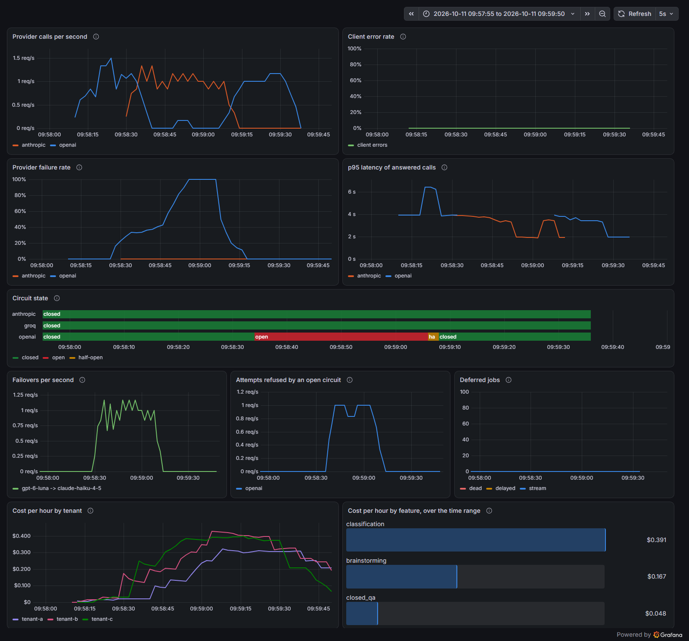
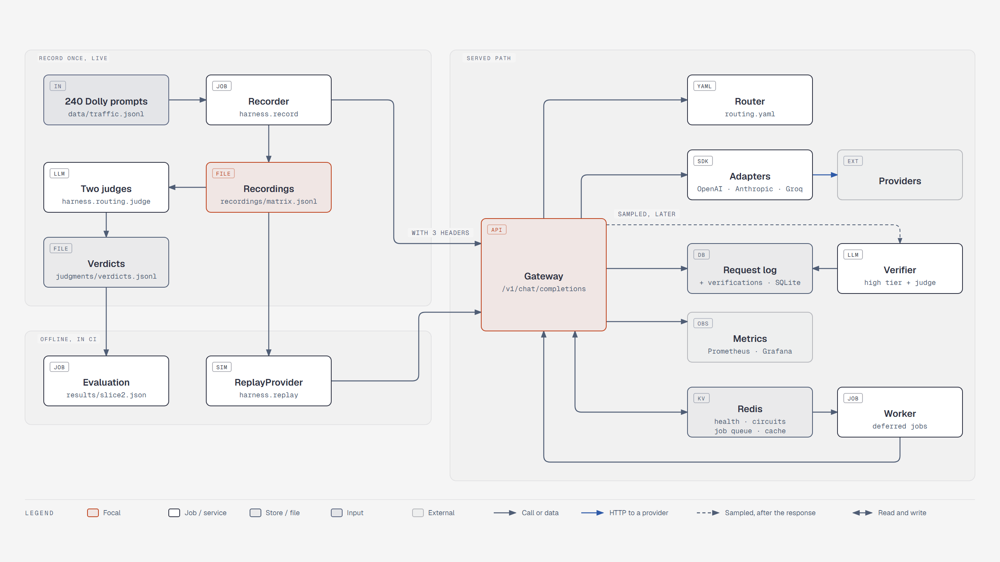

# llm-gateway

Um gateway compatível com a API da OpenAI, na frente de OpenAI, Anthropic e Groq, que roteia cada requisição pelo custo, a atribui a um tenant e a uma feature, e continua respondendo quando um provedor falha. Em 238 prompts reproduzidos, **mandar toda requisição para o modelo mais barato manteve 95,8% das respostas aceitáveis para dois juízes, com 95,6% menos custo que o modelo de referência**, passando numa barra de qualidade pré-registrada; o classificador aprendido que o plano pedia também passou, mas economizou só 61,6%. **Quando o provedor desse modelo falhou em todas as chamadas, o failover manteve os erros do cliente em 0%**, em quedas simuladas e numa execução ao vivo com 90 requisições reais, e um circuit breaker redesenhado sob um estudo pré-registrado parou de chamar o provedor caído depois de 2,7 s, em vez de 20,2 s. **Um cache exato de respostas, com chave por tenant, versão do prompt, modelo e parâmetros, reduziu o custo em 19,8% e a latência p50 de 2,1 s para 1,7 s** num replay de 1.000 consultas no formato de tráfego real; uma camada semântica foi construída, julgada e deixada desligada, porque no limiar pré-registrado ela piorou a latência p95 e sua taxa de acertos errados só pôde ser limitada a 6,7%, não a 1%. As chamadas ao vivo do projeto custaram US$ 4,64 no total.

[English version](README.md)

## Resultado

As quatro fatias estão prontas. Todos os números abaixo são recalculados offline a partir de gravações e execuções commitadas, e o CI falha se um número publicado ficar desatualizado.

### Fatia 4: cache de respostas

Um cache na frente do modelo precisa provar que economiza alguma coisa sem servir respostas erradas. A carga ([harness/cache/prereg.py](harness/cache/prereg.py), fixada antes de qualquer chamada paga) tem 1.000 consultas montadas a partir do Dolly: 600 repetem 160 perguntas, cada uma feita com a redação original ou com uma de 4 paráfrases escritas pelo gpt-4.1-mini, numa distribuição de Zipf em que poucas perguntas voltam muitas vezes; 320 são os registros do Dolly mais próximos dessas perguntas por embedding (redação parecida, quase sempre outra pergunta); 80 são aleatórias. As consultas vêm de três tenants. O replay manda tudo pelo código real do gateway, com as respostas gravadas do gpt-6-luna e os embeddings gravados, então não custa nada e o CI o repete. A taxa de acerto é uma propriedade desta carga, que foi construída para repetir; não é uma afirmação sobre tráfego real.

| | sem cache | só a camada exata (servida) | exata + semântica em 0,96 |
|---|---|---|---|
| taxa de acerto | - | 23,3% | 27,7% (16,7% exata, 11,0% semântica) |
| custo por 1.000 consultas, US$ | 0,0985 | 0,0790 (-19,8%) | 0,0770 (-21,9%) |
| latência p50 | 2.112 ms | 1.728 ms | 2.035 ms |
| latência p95 | 6.200 ms | 5.990 ms | 6.314 ms |

A latência é montada a partir da chamada ao modelo e da chamada de embedding, ambas gravadas; a consulta ao cache em si não entra.

- **A camada exata é a que o gateway serve.** Ela só responde ao mesmo texto, do mesmo tenant, sob o mesmo system prompt, versão de prompt, modelo e parâmetros, então não pode responder a outra pergunta. Só são guardadas respostas que terminaram normalmente, vindas do modelo a que a requisição se destinava.
- **A camada semântica foi julgada, não presumida.** Todo acerto semântico distinto em qualquer limiar de 0,80 a 0,99, 150 pares, foi avaliado pelos juízes da fatia 2 (gpt-4.1-mini e claude-sonnet-5-5): a resposta do cache serve tão bem para esta pergunta quanto a resposta nova do modelo? Eles concordaram nos 150. 7 eram acertos errados, 6 deles entre perguntas diferentes do Dolly: escolas de ensino médio em Arlington respondidas com o número de escolas primárias (similaridade 0,959), "os sete primeiros-ministros mais recentes da Índia" respondidos com três, Shiba Inu a criptomoeda respondida como a raça de cachorro e o inverso, Meiolania respondida como Megalania. O sétimo era uma paráfrase cuja resposta do cache tinha um país fora de ordem.
- **O limiar pré-registrado cumpriu a letra da afirmação, não o espírito.** A regra escolheu o menor limiar com no máximo 0,5% de acertos errados na metade de ajuste: 0,96. Na metade de teste, esse limiar serviu 0 acertos errados em 53, uma estimativa pontual abaixo de 1%, mas o intervalo exato de 95% chega a 6,7% (e a 28,5% nos 11 pares distintos por trás desses acertos). A carga é pequena demais para mostrar uma taxa abaixo de 1%. O limiar também fica 0,001 acima de um acerto errado real.
- **A camada semântica custa latência em toda requisição que ela não responde.** A chamada de embedding levou 329 ms no p50 e 477 ms no p95, e toda requisição que a camada exata erra a paga. Em 0,96, isso deixou o p50 mais lento que só a camada exata e o p95 mais lento que sem cache. Os 2 pontos a mais de economia são US$ 0,002 por 1.000 consultas, porque o gpt-6-luna é barato. Por isso ela está desligada; ligá-la é uma linha no routing.yaml.

| limiar | acertos semânticos | acertos errados | taxa de acertos errados |
|---|---|---|---|
| 0,80 | 269 | 8 | 3,0% |
| 0,87 | 217 | 2 | 0,9% |
| 0,90 | 169 | 2 | 1,2% |
| 0,95 | 128 | 1 | 0,8% |
| 0,96 | 110 | 0 | 0,0% |
| 0,98 | 40 | 0 | 0,0% |

As duas metades juntas; a curva completa, por metade, está em [results/slice4.md](results/slice4.md).

- **É a chave que separa os tenants.** No replay com só a pergunta como chave, 228 de 371 acertos teriam servido uma resposta calculada para outro tenant. Depois da troca da versão do system prompt, nenhum acerto usou uma resposta guardada sob a versão antiga; as mesmas 200 consultas sob a versão antiga tiveram 198 acertos.
- **Uma checagem humana às cegas confirmou as recusas dos juízes.** Avaliei 22 pares sem ver os veredictos: 15 que os juízes aceitaram e todos os 7 que recusaram. Recusei 6 dos 7 e concordei em 19 de 22. Duas discordâncias foram paráfrases que recusei por omitir ou acrescentar uma frase que ninguém pediu, o que o critério não penaliza; na terceira, os juízes pegaram o país fora de ordem e eu não.

O cache de prefixo do provedor ficou fora do escopo: o system prompt tem uns 15 tokens, e a OpenAI só faz cache de prompts com pelo menos 1.024 tokens nos modelos GPT-5.6 e posteriores ([guia de prompt caching](https://developers.openai.com/api/docs/guides/prompt-caching)).

### Fatia 3: confiabilidade sob falhas de provedor

Duas instâncias do gateway compartilham a saúde de cada provedor, o estado dos circuitos e uma fila de tarefas no Redis. Os testes de falha rodam sobre provedores simulados que reproduzem as respostas gravadas com a latência gravada, então não custam nada e podem ser repetidos: tráfego em malha aberta a 4 requisições por segundo, uma falha no openai (o provedor da faixa low) dos 20 s aos 60 s de uma execução de 100 s, 3 repetições por célula. O desenho e os critérios de aprovação de cada estudo foram commitados antes das execuções ([prereg.py](harness/chaos/prereg.py), [prereg_v2.py](harness/chaos/prereg_v2.py), [deferrable.py](harness/chaos/deferrable.py)).

| falha no openai | erros do cliente, sem failover | erros do cliente, com failover | breaker v1 abriu após | breaker v2 abriu após | chamadas desperdiçadas, v1 / v2 |
|---|---|---|---|---|---|
| queda (toda chamada falha) | 100,0% | 0,0% | 20,2 s | 2,7 s | 81 / 11 |
| parcial (50% das chamadas falham) | 48,8% | 0,0% | nunca | 5,2 s | 84 / 15 |
| timeouts (toda chamada trava 10 s) | 100,0% | 0,0% | 30,2 s | 12,5 s | 120 / 51 |
| latência (35 s a mais) | 0,0% | 0,0% | 37,5 s | 32,5 s | 0 / 0 |

Medianas de 3 repetições. Chamadas desperdiçadas são requisições na janela da falha que fizeram uma chamada ao openai que falhou. Com breaker, os erros do cliente ficam em 0,0% em todos os cenários.

- **É o failover que mantém os clientes respondidos; o breaker economiza chamadas desperdiçadas e tempo.** Requisições enviadas com `"model": "auto"` passam para o fallback da faixa diante de um erro que admite nova tentativa. Sob timeouts, a latência p50 foi de 12,9 s só com failover, 11,7 s com o breaker v1 e 3,5 s com o v2, porque um circuito aberto pula a espera de 10 s.
- **A v2 substituiu a v1 depois de uma comparação pré-registrada.** A v1 contava a janela de saúde compartilhada de 60 s, então numa queda total ela precisava esperar as falhas superarem as chamadas saudáveis que ainda estavam na janela (20,2 s), e no cenário de latência chamadas lentas que terminaram depois do circuito fechar o reabriram. A v2 conta as últimas 20 chamadas admitidas desde a última mudança do circuito, ignora as admitidas antes disso e marca uma chamada como lenta enquanto ela ainda está rodando. As duas versões rodaram de novo, intercaladas, na mesma sessão. Todos os critérios se mantiveram: abertura mais rápida nos três cenários de detecção, abertura com 50% de erros, nenhuma reabertura depois da recuperação, nenhum disparo sem falha ou com 10% de erros, e nenhuma métrica do cliente pior que na v1 ([results/slice3_breaker_v2.md](results/slice3_breaker_v2.md)). A v2 foi desenhada depois de ver os resultados da v1; os critérios foram fixados antes das execuções da v2, não antes das da v1.
- **A v2 tem custos que os critérios não cobriram.** Uma janela de 20 chamadas é uma amostra pequena: sob uma taxa de erro constante bem abaixo do limiar de 50%, ela ainda pode ver metade das chamadas falhar. A probabilidade binomial exata de uma avaliação disparar é 0,26% com 20% de erros e 4,8% com 30% de erros (calculada, não medida). Com 50% de erros a v2 manda 91% do tráfego para o fallback, contra 52% na v1, e o fallback custa cerca de doze vezes mais. O tempo para fechar depois da recuperação depende de onde está o ciclo de abertura e sonda: sob timeouts foi de 15,0 s na v2 e 8,7 s na v1.
- **Nenhum dos breakers resolve latência adicionada.** Com 35 s a mais em toda chamada ao openai, o p95 foi de 41,0 s em todas as configurações; o breaker só abre quando as chamadas já passaram de 30 s.
- **A faixa low faz failover para o claude-haiku-4-5, não para o gpt-oss-20b.** Com um juiz (gpt-4.1-mini), o Haiku foi aceitável em 97,1% dos 238 prompts, o mesmo que o gpt-6-luna, enquanto o gpt-oss-20b caiu para 85,3% (11,8 pontos a menos, IC 95% [7,6; 16,4]). O Haiku custa cerca de doze vezes o luna enquanto dura o failover. A qualidade igual depende do juiz: sob o consenso mais rigoroso dos dois juízes da fatia 2, o Haiku foi aceito em 85,7%, contra 95,8% do luna ([results/slice3_fallback_quality.md](results/slice3_fallback_quality.md)).

**Trabalho adiável.** Quando o provedor da faixa low e o provedor do fallback dela falham juntos, uma requisição interativa não tem para onde ir: neste teste, todas as requisições interativas durante a queda dupla falharam. Uma requisição enviada com `X-Deferrable: true` vai para uma fila (202 e um id de tarefa), e um worker a manda pelo gateway mais tarde, com backoff. Teste: openai e anthropic falham juntos dos 20 s aos 60 s, 160 tarefas chegam a 2 por segundo, cada uma enviada duas vezes com a mesma `Idempotency-Key`, e um dos dois workers é morto aos 65 s. A execução 1 expôs dois defeitos; a execução 2 é o mesmo teste depois de corrigi-los ([results/slice3_deferrable.md](results/slice3_deferrable.md)).

| execução | tarefas concluídas | tarefas mortas | não terminadas aos 300 s | tarefas respondidas duas vezes | envios duplicados absorvidos | fila vazia após o fim da falha |
|---|---|---|---|---|---|---|
| 1: uma tarefa por vez, 8 tentativas | 74 a 80 de 160 | 16 a 26 | 54 a 70 | 0 | 160 de 160 | nunca |
| 2: 8 tarefas em paralelo, orçamento de 15 minutos de idade | 160 de 160 | 0 | 0 | 0 | 160 de 160 | 55 a 58 s |

Faixas sobre 3 repetições. O tempo para esvaziar a fila na execução 2 inclui os 20 s em que tarefas ainda chegavam. A entrega é pelo menos uma vez: uma tarefa cujo worker morre depois que o modelo respondeu e antes de o resultado ser gravado é respondida de novo. Nenhuma execução caiu nessa janela, então 0 duplicatas é o que foi observado, não uma garantia.

**Execução ao vivo.** A mesma queda, com modelos reais: duas instâncias, 90 requisições do Dolly a 1 por segundo, respostas limitadas a 256 tokens, o openai falhando em toda chamada dos 20 s aos 60 s (a falha é injetada no gateway, então as chamadas que falham não custam nada). As 90 requisições foram respondidas: 20 pelo gpt-6-luna antes da falha, 40 das 41 durante a falha pelo claude-haiku-4-5, e 27 das 29 depois dela pelo luna de novo. O circuito abriu depois de 10 falhas nas últimas 20 chamadas, uma sonda falhou enquanto a falha durava, e a seguinte o fechou. 15 das 90 respostas foram cortadas em 256 tokens, o limite que manteve o pior caso da execução em US$ 0,22; ela custou US$ 0,031 ([resumo](data/chaos/live/slice3_live_video/summary.json)).

https://github.com/user-attachments/assets/44096512-893a-4faf-9360-3e24214e68e7



O vídeo é o painel durante essa execução, em velocidade 2x. O Prometheus coleta a cada 2 s, então um estado half-open mais curto que isso pode faltar na linha do tempo do circuito: a sonda que falhou não aparece.

### Fatia 2: roteamento por custo, verificado por juízes

Cada resposta candidata foi avaliada contra a resposta de referência (gpt-6.1-sol) por dois juízes de dois provedores, gpt-4.1-mini e claude-sonnet-5-5; ela só conta como aceitável quando os dois aceitam. Uma resposta cortada pelo limite de saída ou vazia falha por regra, em todas as faixas. As políticas aprendidas foram avaliadas fora da amostra de treino, com validação cruzada em 5 partes estratificadas por classe de requisição. As políticas, o limiar, a barra de qualidade (limite inferior do intervalo de 95% de pelo menos 90%) e as comparações foram fixados em [harness/routing/prereg.py](harness/routing/prereg.py) antes de existir qualquer veredito.

| política | respostas aceitáveis (IC 95%) | custo por 1.000 requisições, US$ | redução de custo vs always_high | low / medium / high | passa na barra |
|---|---|---|---|---|---|
| always_high (gpt-6.1-sol) | 99,6% [98,7; 100,0] | 2,046 | 0% | 0 / 0 / 100% | sim |
| **always_low (gpt-6-luna)** | **95,8% [93,3; 98,3]** | **0,089** | **95,6%** | 100 / 0 / 0% | sim |
| always_medium (claude-haiku-4-5) | 85,7% [81,1; 89,9] | 1,104 | 46,1% | 0 / 100 / 0% | não |
| feature_table | 95,4% [92,4; 97,9] | 0,566 | 72,3% | 75 / 13 / 12% | sim |
| classifier (principal, pré-registrada) | 95,8% [93,3; 98,3] | 0,786 | 61,6% | 67 / 0 / 33% | sim |
| oracle (roteamento perfeito, um teto) | 99,6% [98,7; 100,0] | 0,190 | 90,7% | 96 / 3 / 2% | sim |

O que a tabela mostra:

- **A política mais simples venceu.** O classificador passou na barra, como pré-registrado, mas o always_low chegou à mesma taxa de aceite por cerca de um nono do custo. O classificador mandou um terço do tráfego para o modelo caro e não ganhou nenhuma resposta aceitável com isso. Contra a tabela por feature, o teste de McNemar pré-registrado achou 1 prompt a favor do classificador e 0 contra (p = 1,0), e o classificador custou US$ 0,22 a mais por 1.000 requisições.
- **Há espaço para um roteador, e as características baratas não o encontram.** O oráculo chega a 99,6% mandando só 2% das requisições para o modelo caro. Tamanho do prompt, presença de contexto, algumas palavras-chave da instrução e a classe de requisição não preveem em quais 4% das requisições o gpt-6-luna falha.
- **A faixa medium foi pior que a low.** O claude-haiku-4-5 custa doze vezes o gpt-6-luna e foi aceito em 85,7% dos prompts, contra 95,8%. Ordem de preço não é ordem de qualidade.
- **Os juízes concordam em 93,2% dos 474 pares** (kappa de Cohen 0,36); o Sonnet é o mais rigoroso. Um avaliador humano às cegas e o consenso dos juízes concordam em 27 de 30 respostas sorteadas. As 3 divergências são respostas que o humano aceitou e os juízes recusaram por um erro factual nomeado (dois instrumentos classificados ao contrário, Melbourne listada na costa leste, um limite rígido de tamanho para planetas redondos). O humano aceitou as 30, então o kappa é 0 por construção e a contagem bruta é o número informativo.

O gateway serve o `always_low` a partir do [llm_gateway/routing.yaml](llm_gateway/routing.yaml), relido sempre que muda. Um verificador por amostragem acompanha essa escolha depois que a resposta é enviada: ele faz a mesma pergunta à faixa high, pede ao gpt-4.1-mini que julgue a resposta roteada e registra cada veredito, dentro de um teto diário de gasto. A partir dos vereditos gravados ([results/slice2_verifier.md](results/slice2_verifier.md)):

| taxa de amostragem | acréscimo por 1.000 requisições, US$ | acréscimo vs custo de servir | redução total vs always_high | falhas pegas por 1.000 |
|---|---|---|---|---|
| 1% | 0,023 | 26% | 94,5% | 0,3 |
| 5% (configurada) | 0,116 | 131% | 90,0% | 1,5 |
| 10% | 0,233 | 261% | 84,3% | 2,9 |

Uma verificação custa cerca de 26 vezes o que custou servir a requisição, porque vai para o modelo que o always_low evita. O verificador é um instrumento de monitoramento: mede a taxa de falha e junta falhas de roteamento como exemplos de treino (com as características do prompt, nunca o texto); ele não conserta a resposta que o usuário já recebeu. Com um juiz só, ele marca 7 das 10 falhas que o consenso dos dois juízes encontra.

Tabelas completas, incluindo o aceite por classe de requisição: [results/slice2.md](results/slice2.md).

### Fatia 1: a espinha

Cada um dos 240 prompts foi enviado uma vez a cada um dos seis modelos e gravado, por US$ 1,92.

| modelo | faixa | custo por 1.000 requisições, US$ (IC 95%) | média de tokens de saída | cortadas em 1.024 tokens | latência p50, s | latência p95, s |
|---|---|---|---|---|---|---|
| gpt-6.1-sol | high | 2,12 [1,88; 2,36] | 185 | 3 de 240 | 4,7 | 16,5 |
| claude-sonnet-5-5 | high | 4,21 [3,85; 4,57] | 381 | 7 de 240 | 3,4 | 10,1 |
| claude-haiku-4-5 | medium | 1,13 [1,05; 1,21] | 197 | 0 de 240 | 2,3 | 4,7 |
| gpt-oss-120b (Groq) | medium | 0,32 [0,29; 0,35] | 483 | 62 de 240 | 1,3 | 2,9 |
| gpt-6-luna | low | 0,09 [0,08; 0,10] | 158 | 2 de 240 | 2,3 | 6,1 |
| gpt-oss-20b (Groq) | low | 0,12 [0,11; 0,13] | 357 | 18 de 240 | 0,6 | 1,7 |

- **Preço por token não é custo por requisição.** O gpt-6.1-sol e o claude-sonnet-5-5 têm o mesmo preço de tabela, mas o Sonnet custa o dobro por requisição: cerca do dobro de tokens de saída (381 contra 185), e os mesmos prompts contam cerca de 50% mais tokens de entrada do lado da Anthropic (202 contra 133).
- **O limite de saída derruba modelos de dois jeitos.** O gpt-oss-120b foi cortado em 62 de 240 respostas porque escreve respostas longas, muitas vezes com tabelas. As 5 respostas cortadas dos modelos GPT-6 vieram vazias: o raciocínio consumiu o limite inteiro, e a chamada foi cobrada mesmo assim.
- **Toda requisição é atribuída.** As 1.440 requisições reproduzidas foram registradas com tenant, feature e request id, e o custo atribuído por tenant soma o registro de gastos.
- **O gateway acrescenta 0,4 ms (p50) e 0,6 ms (p95)** dentro do processo, sem contar o tempo do provedor.

Detalhes: [results/slice1.md](results/slice1.md). A latência é o que uma máquina viu em 2026-10-07, uma chamada por vez, com a rede incluída.

| fatia | o que acrescenta | estado |
|---|---|---|
| 1 | espinha: API, registro, metadados, log, métricas, gravação e replay | pronta |
| 2 | roteamento por custo: mapa de faixas em YAML, qualidade julgada, comparação pré-registrada de políticas, verificador por amostragem | pronta |
| 3 | confiabilidade: saúde por provedor, circuit breaker, failover, fila com retry, teste de caos, painel | pronta |
| 4 | cache: camadas exata e semântica, chave versionada por tenant, acertos errados julgados, curva de precisão | pronta |

Nenhum sistema em produção manda tráfego para este gateway. O tráfego é um dataset público, reproduzido.

## Caminho dos dados

<picture>
  <source media="(prefers-color-scheme: dark)" srcset="docs/diagrams/data-path-dark.png">
  
</picture>

As chamadas ao vivo acontecem uma vez: a gravação e depois os juízes. Tudo o que vem depois, incluindo os números publicados e as checagens do CI, lê as gravações commitadas. Os testes de falha da fatia 3 rodam o código real do gateway contra provedores simulados, montados a partir das mesmas gravações; só a execução ao vivo chama modelos reais.

## Decisões de design

**Gravar uma vez, reproduzir offline.** As 1.440 respostas gravadas e os 948 vereditos estão commitados. As políticas de roteamento são avaliadas consultando as respostas gravadas, e o CI regenera cada JSON publicado e falha quando ele difere do arquivo commitado. Do que abri mão: a latência é um retrato único, de uma máquina num dia.

**Rótulos vindos do resultado julgado, sob um desenho pré-registrado.** O guia de roteamento por custo que este projeto segue pede 200 prompts rotulados à mão. Em vez disso, o rótulo de cada prompt é se a resposta de cada faixa foi aceitável, que é o que um roteador precisa saber, julgado por dois juízes de dois provedores, nenhum deles candidato. O desenho foi commitado antes de existir qualquer veredito, e uma checagem humana às cegas de 30 respostas foi commitada antes da execução completa dos juízes. Do que abri mão: os rótulos são tão bons quanto os juízes; a checagem humana pôde confirmar os aceites deles, mas, tendo aceitado tudo, não pôde testar as recusas.

**Adaptadores próprios sobre os SDKs oficiais, sem o LiteLLM.** Três provedores precisam de só dois formatos de API, porque o Groq fala o da OpenAI. Ter os adaptadores significa ter a taxonomia de erros que o acompanhamento de saúde da fatia 3 conta, e poder desligar as retentativas dos SDKs, já que uma retentativa escondida no SDK aumenta a latência e esconde falhas. Do que abri mão: um quarto provedor é código novo, e o gateway não repassa streaming nem tools. Sobre "por que não o LiteLLM Proxy": o Proxy entrega o mecanismo; este projeto é sobre a evidência em volta dele, e o harness de gravação, replay e juiz apontaria para o Proxy do mesmo jeito.

**Um orçamento que o código impõe.** O projeto inteiro tem US$ 10. Antes de uma execução paga começar, o total do registro de gastos mais o pior caso da execução precisa ficar abaixo disso; o verificador do gateway aplica a mesma regra ao teto diário. O pior caso é limitado pelo teto de saída e pelos bytes UTF-8 do prompt (o dobro para a Anthropic, que não documenta seu tokenizador). Do que abri mão: o limite é folgado, quatro vezes o custo real da gravação, então os dois juízes não puderam rodar de uma vez e rodaram um depois do outro.

**Testes de falha com provedores simulados, uma execução ao vivo.** Os testes de falha usam o gateway, o Redis e o breaker reais, e trocam só a chamada ao provedor por uma reprodução da resposta gravada com a latência gravada, com as falhas injetadas na frente dela. Isso tornou as 78 execuções commitadas (36 da v1, 36 da comparação com a v2, 6 da fila) repetíveis e gratuitas. Do que abri mão: modos de falha reais (headers de rate limit, respostas parciais, um provedor lento só para alguns modelos) não são exercitados; a execução ao vivo mostra o mecanismo com modelos reais, mas é uma execução só.

**Estado compartilhado no Redis, que falha aberto.** As janelas de saúde, o estado dos circuitos e a fila de tarefas ficam no Redis, então duas instâncias concordam sobre qual provedor caiu. As mudanças de circuito usam WATCH/MULTI, e um circuito half-open admite uma sonda por meio de uma concessão (SET NX com expiração), para que duas instâncias não sondem ao mesmo tempo. Se o Redis estiver fora do ar, o breaker deixa as chamadas passarem e as escritas de saúde são contadas como perdidas. Do que abri mão: o Redis passou a ser uma dependência, e sem ele o gateway serve sem breaker.

**Failover só quando o gateway escolheu o modelo.** Uma requisição com `"model": "auto"` pode ser respondida pelo fallback da faixa; uma requisição que nomeia um modelo recebe esse modelo ou um erro. A resposta lista cada tentativa, e o log de requisições registra qual modelo deveria ter respondido. Do que abri mão: um cliente que nomeia um modelo não tem proteção contra uma queda.

**Pelo menos uma vez, com chaves de idempotência.** Uma tarefa adiada é gravada, confirmada e concluída em transações do Redis, e a mesma `Idempotency-Key` do mesmo tenant nunca cria uma segunda tarefa. Exatamente uma vez de ponta a ponta exigiria a cooperação do provedor: um worker pode morrer depois que o modelo respondeu e antes de o resultado ser gravado. Do que abri mão: nessa janela a tarefa é respondida duas vezes; os testes contam isso e viram 0, sem uma execução que caísse na janela.

**Uma chave de cache com tudo menos a pergunta.** A chave guarda o tenant, a mensagem de sistema, o `X-Prompt-Version` do cliente, o modelo a que a requisição se destina (depois do roteamento), a temperatura e o limite de saída, mais as mensagens; a camada semântica só busca entre entradas que compartilham tudo menos as mensagens. Um system prompt alterado ou uma versão nova nunca encontra as respostas de ontem, e um tenant nunca recebe as de outro. No Redis as chaves são `llmgw:cache/<tenant>/<feature>/<hash>`, com "/" porque os identificadores podem conter ":" e invalidar o tenant "a" não pode atingir o tenant "a:b". Do que abri mão: dois tenants que fazem a mesma pergunta pagam por ela duas vezes.

**A camada semântica atrás de um contrato de índice.** O gateway busca com o Redis Query Engine (um índice de cosseno exato, FLAT, cujo vetor fica no próprio registro da resposta, então o TTL e a invalidação o removem); os testes e o replay da avaliação usam um índice em memória com o mesmo contrato, e um teste contra um Redis real, que roda no CI com um serviço Redis, garante que os dois devolvem os mesmos vizinhos. Ele pegou um bug real: um "-" no namespace é sintaxe de consulta se não for escapado. Do que abri mão: o replay não mede o tempo das consultas ao Redis, então os números de latência deixam a consulta de fora.

## O que não funcionou

- **O cache semântico, neste nível de preço.** Funcionou como projetado, e os juízes acharam os acertos errados onde eles eram esperados, mas com um modelo barato ele economizou US$ 0,002 por 1.000 consultas além da camada exata, enquanto acrescentava uma chamada de embedding a toda requisição que a camada exata errava. Sua taxa de acertos errados só pôde ser limitada a 6,7%, não ao 1% que o plano pedia.
- **A carga foi menor que a afirmação.** Só 121 dos 160 intents foram sorteados pela distribuição de Zipf, só 150 pares distintos de acerto semântico apareceram em algum limiar, e os negativos difíceis em geral não eram difíceis (similaridade mediana de 0,56 com o intent). Mostrar uma taxa de acertos errados abaixo de 1% com confiança exige algumas centenas de acertos julgados perto do limiar escolhido.
- **Dois pontos em que o pré-registro estava errado.** Ele dizia que toda consulta deveria errar depois da troca do system prompt; consultas repetidas dentro dessas 200 acertaram respostas guardadas já sob a versão nova, então o relatório conta os acertos em respostas guardadas sob a versão antiga (0). Ele também não listava a feature na chave, enquanto a chave do gateway inclui uma; o replay manda todas as consultas sob uma única feature para seguir o pré-registro.
- **O contrafactual do embedding sem contexto.** Ele deveria mostrar quanto custaria deixar o contexto fora do embedding; nesta carga quase nenhum par de textos tem a mesma instrução com contextos diferentes, então ele achou 1 caso em 25.320 pares e mostra pouco.

- **O breaker v1.** Ele levou 20,2 s para abrir numa queda total, porque a janela de 60 s ainda guardava as chamadas saudáveis de antes da falha, e no cenário de latência chamadas lentas que terminaram depois do circuito fechar o reabriram. A v2 o substituiu.
- **O primeiro teste de latência.** O cliente HTTP do gerador de carga manteve o pool padrão de 100 conexões, então, com chamadas levando 37 s, requisições ficaram na fila do próprio cliente e a carga deixou de ser em malha aberta. O limite foi removido e só esse cenário rodou de novo; a nota dos resultados registra isso.
- **A primeira execução da fila.** O worker processava uma tarefa por vez, cerca de 0,4 por segundo contra 2 chegando, e 54 a 70 tarefas ainda não tinham sido lidas quando a execução terminou. O orçamento de novas tentativas contava tentativas, e um circuito aberto falha uma tentativa na hora, então 16 a 26 tarefas gastaram as 8 tentativas dentro de uma queda de 40 s. A execução 2 mantém 8 tarefas em paralelo e limita as novas tentativas pela idade da tarefa.
- **Requisições interativas numa queda dupla.** Quando o provedor da faixa low e o do fallback dela falham juntos, toda requisição interativa falha; só as requisições adiáveis passam.
- **Falhas de latência.** Nenhum dos breakers encurta uma falha que só acrescenta latência: o p95 ficou em 41,0 s em todas as configurações.

- **O roteador aprendido.** O classificador pré-registrado passou na barra de qualidade e ainda assim foi a escolha errada: o always_low igualou o aceite dele por cerca de um nono do custo. As características baratas do prompt que ele usou não previram onde o gpt-6-luna falha.
- **A faixa medium.** O claude-haiku-4-5 deveria ficar entre o modelo barato e o caro; custou doze vezes o barato e foi aceito menos vezes.
- **Dois prompts sem referência.** Em dois prompts de escrita criativa os dois modelos da faixa high falharam (um vazio, um cortado), enquanto os baratos terminaram. Sem resposta de referência para comparar, eles saíram da avaliação, que ficou com 238.
- **A checagem humana.** Aceitei as 30 respostas que avaliei, incluindo três com erros factuais que os juízes apontaram. Isso deixa o kappa em 0 e mostra o limite da checagem.
- **Duas afirmações que quase publiquei.** Um rascunho do relatório do verificador dizia que verificar com dois juízes custaria vinte vezes mais (medido: 2,4 vezes) e que o juiz único não dava alarmes falsos (verdade por construção, portanto sem informação). As duas foram corrigidas antes do commit.
- Da fatia 1: a primeira fonte de tráfego (69 perguntas jurídicas de uma só classe) foi trocada pelo Dolly; o Llama 3.1 8B no Groq deixou de ser self-serve; minha estimativa da gravação foi o dobro do custo real; o teto de 1.024 tokens cortou 92 de 1.440 respostas.

## Setup

Requer o [uv](https://docs.astral.sh/uv/). O Python 3.12 está fixado.

```bash
uv sync
uv run pytest                              # offline; também regenera os números publicados e compara
uv run python -m harness.report            # results/slice1.md a partir da gravação, offline
uv run python -m harness.routing.evaluate  # results/slice2.md a partir da gravação e dos vereditos, offline
```

Para servir o gateway ou fazer novas chamadas, copie o `.env.example` para `.env` e preencha `OPENAI_API_KEY`, `ANTHROPIC_API_KEY` e `GROQ_API_KEY`.

```bash
uv run --env-file .env uvicorn llm_gateway.main:app --port 8000
curl http://localhost:8000/v1/chat/completions \
  -H "Content-Type: application/json" \
  -H "X-Tenant-Id: tenant-a" -H "X-Feature: open_qa" -H "X-Request-Id: demo-1" \
  -d '{"model": "auto", "messages": [{"role": "user", "content": "Name a river."}]}'
uv run --env-file .env python -m harness.record --dry-run   # plano e custo no pior caso, sem chamadas
```

A fatia 3 precisa do Docker para o Redis, o Prometheus e o Grafana (todos presos a 127.0.0.1). Os testes de falha não precisam de chave de API.

```bash
docker compose up -d                                  # painel do Grafana em http://127.0.0.1:3000/d/llm-gateway
uv run python -m harness.chaos.scenarios --study v2   # a comparação dos breakers, cerca de 1 hora, provedores simulados
uv run python -m harness.chaos.compare_v2             # results/slice3_breaker_v2.md a partir das execuções commitadas
uv run python -m harness.chaos.deferrable             # results/slice3_deferrable.md a partir das execuções commitadas
uv run python -m harness.chaos.live --ceiling                  # pior caso da execução ao vivo, sem chamadas
uv run python -m harness.cache.evaluate                       # results/slice4.md: o replay do cache em todos os limiares, offline
```

O gateway servido responde requisições repetidas pela camada exata do cache quando `LLM_GATEWAY_REDIS_URL` está definida (veja `cache:` no routing.yaml); `DELETE /admin/cache?tenant=...&feature=...` com `X-Admin-Token` (`LLM_GATEWAY_ADMIN_TOKEN`) invalida entradas. Respostas servidas pelo cache dizem isso em `gateway.cache`.

Com `LLM_GATEWAY_REDIS_URL` definida, o gateway servido compartilha a saúde e os circuitos pelo Redis e aceita `X-Deferrable: true`; rode `uv run python -m llm_gateway.worker` para esvaziar a fila e use `GET /v1/jobs/<id>` para pegar o resultado.

Uma requisição sem os três headers é recusada com 400. `"model": "auto"` roteia pelo `routing.yaml`, e o `gateway.routing` da resposta diz qual faixa foi escolhida e por quê; um modelo nomeado ignora o roteador. `GET /v1/models` lista o registro com os preços, e `GET /metrics` serve as métricas do Prometheus.

Os prompts em `data/traffic.jsonl` derivam do databricks-dolly-15k e estão sob CC BY-SA 3.0; veja [data/README.md](data/README.md).
